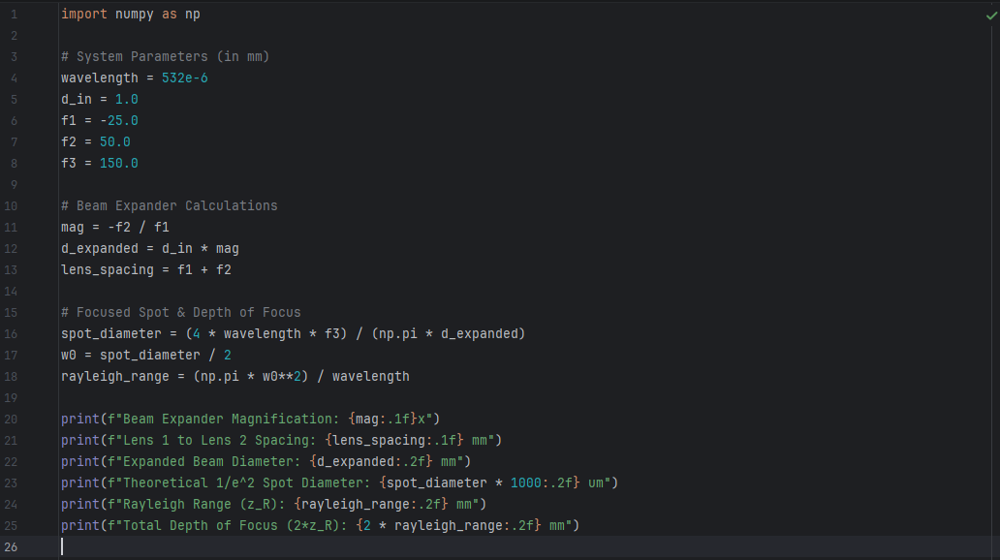
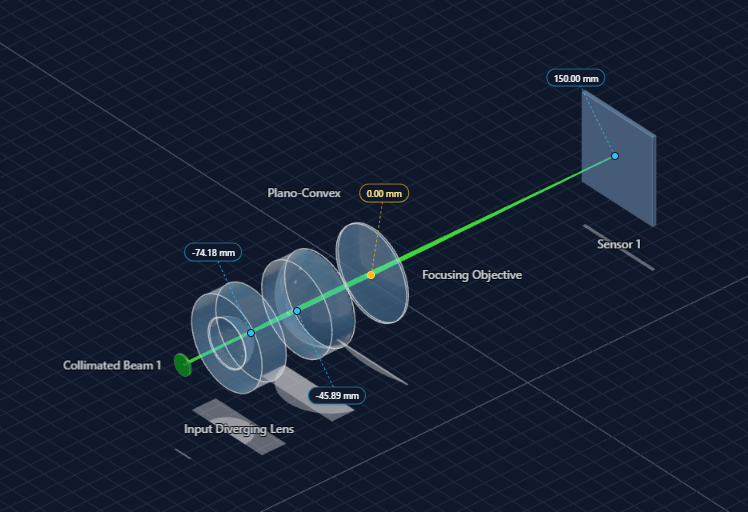
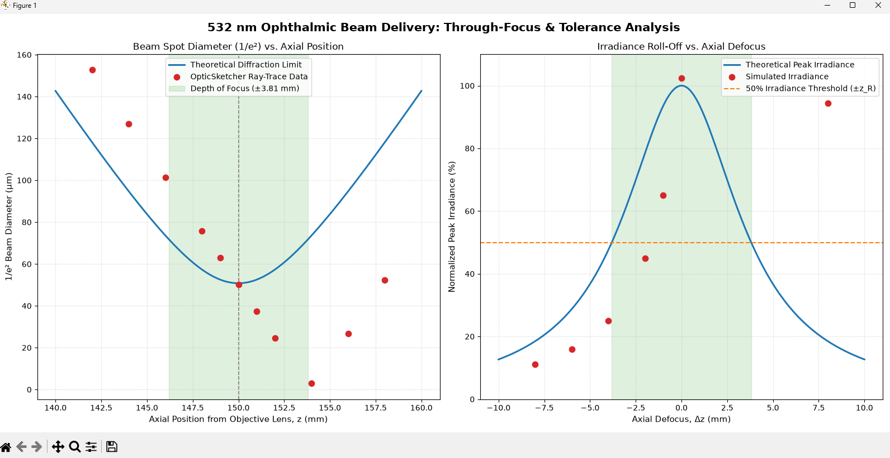
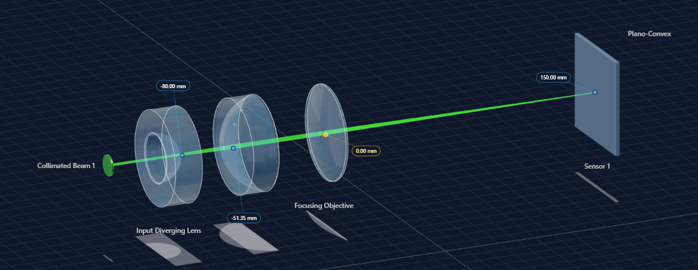
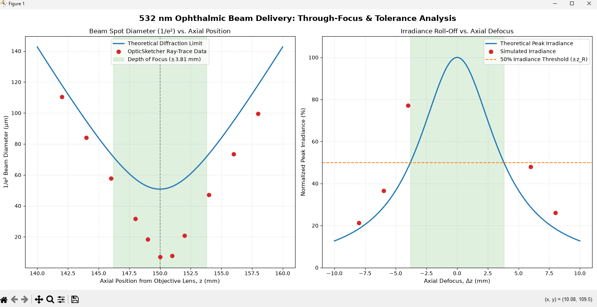

# 532 nm Ophthalmic Laser Beam Delivery & Tolerance Analysis

An end-to-end optical engineering design, ray-trace simulation, and sensitivity study for a 532 nm surgical retinal photocoagulation beam delivery system. This project bridges first-principles Gaussian beam propagation with thick-lens ray-tracing optimization in OpticSketcher and quantitative Python data analysis.

---

## 1. Problem Statement & System Requirements

Ophthalmic laser procedures (such as retinal photocoagulation) require delivering a tightly focused, circularly symmetric laser spot at a comfortable working distance from the objective lens while maintaining predictable irradiance across minor axial patient movements.

### Target Optical Specifications
* **Laser Wavelength ($\lambda$):** 532 nm (Frequency-doubled Nd:YAG, $\text{TEM}_{00}$, $M^2 = 1.0$)
* **Input Collimated Beam Diameter ($D_{\text{in}}$, $1/e^2$):** 1.0 mm (fiber collimator output)
* **Final Working Distance ($f_{\text{obj}}$):** 150.0 mm
* **Target Focused Spot Diameter ($2w_0$ at $1/e^2$):** $\approx 50.0\ \mu\text{m}$
* **Glass Substrate:** N-BK7 ($n \approx 1.5195$ at 532 nm)

---

## 2. First-Principles Theoretical Design

### Beam Expansion Ratio
To achieve a $50\ \mu\text{m}$ diffraction-limited spot at a 150 mm focal length, the 1.0 mm input beam must first be expanded to increase the focusing numerical aperture (NA):

$$D_{\text{expanded}} = \frac{4 \lambda f_{\text{obj}}}{\pi (2w_0)} = \frac{4 (532 \times 10^{-6}\ \text{mm})(150\ \text{mm})}{\pi (0.050\ \text{mm})} \approx 2.03\ \text{mm}$$

* **Required Magnification ($M$):** $2.0\times$
* **Architecture Choice:** A **Galilean beam expander** (negative input lens + positive collimating lens) was selected over a Keplerian design to avoid an internal focal point, eliminating the risk of air ionization or dust breakdown at high surgical peak powers.

### Optical Component Selection & Depth of Focus
* **Lens 1 (Diverging):** Plano-Concave, $f_1 = -25.0\ \text{mm}$, center thickness $t_c = 2.0\ \text{mm}$
* **Lens 2 (Collimating):** Plano-Convex, $f_2 = +50.0\ \text{mm}$, center thickness $t_c = 5.3\ \text{mm}$
* **Lens 3 (Objective):** Plano-Convex, $f_3 = +150.0\ \text{mm}$, center thickness $t_c = 3.0\ \text{mm}$
* **Theoretical Rayleigh Range ($z_R$):**
  $$z_R = \frac{\pi w_0^2}{\lambda} = \frac{\pi (0.0254\ \text{mm})^2}{532 \times 10^{-6}\ \text{mm}} \approx \mathbf{3.81\ \text{mm}}$$
* **Total Theoretical Depth of Focus ($2z_R$):** **$\pm 3.81\ \text{mm}$ ($7.62\ \text{mm}$ total)** (50% peak irradiance threshold)

---

## 3. Optical Layout & Iterative Optimization

To minimize third-order spherical aberration, all plano-convex lenses were oriented with their curved surfaces facing the wider collimated beam path and their flat (plano) surfaces facing the diverging or converging beam waists.

### Iteration 1: Uncompensated Thin-Lens Baseline
* **Setup:** Lens spacing initialized using the ideal thin-lens approximation ($d_{12} = f_1 + f_2 = 25.0\ \text{mm}$).
* **Finding:** The simulated focal waist shifted downstream to **$z = 154.0\ \text{mm}$** (**$+4.0\ \text{mm}$ axial error**), with a geometric waist diameter of $\approx 3.0\ \mu\text{m}$.
* **Root Cause:** Physical glass center thicknesses ($2.0\ \text{mm}$ and $5.3\ \text{mm}$) shifted the optical principal planes inside the N-BK7 elements, leaving slight residual divergence exiting Lens 2.

### Iteration 2: Thickness-Compensated Optimization
* **Setup:** Adjusted the physical air gap between Lens 1 and Lens 2 to account for thick-lens principal plane offsets until exiting rays achieved full collimation.
* **Finding:** Pulled the simulated focal waist directly onto the target **$z = 150.0\ \text{mm}$** working distance (**$0.0\ \text{mm}$ focal error**) with a symmetric through-focus profile and a $\sim 5.5\ \mu\text{m}$ geometric blur circle.

---

## 4. Quantitative Comparison & Engineering Takeaways

| Metric | Theoretical Target | Iteration 1 (Uncompensated) | Iteration 2 (Optimized) |
| :--- | :--- | :--- | :--- |
| **Focal Plane Location ($z_0$)** | $150.0\ \text{mm}$ | $154.0\ \text{mm}$ ($+4.0\ \text{mm}$ shift) | **$150.0\ \text{mm}$ ($0.0\ \text{mm}$ error)** |
| **Waist Spot Size** | $50.8\ \mu\text{m}$ (Diffraction Limit) | $\sim 3.0\ \mu\text{m}$ (Geometric) | **$\sim 5.5\ \mu\text{m}$ (Geometric)** |
| **Depth of Focus ($2z_R$)** | $\pm 3.81\ \text{mm}$ | Shifted outside nominal window | **Centered at $150.0\ \text{mm}$** |

### Key Engineering Conclusions
1. **Thick-Lens Principal Plane Compensation:** Neglecting lens center thickness in a $2\times$ Galilean expander introduces a $+4.0\ \text{mm}$ downstream focal shift at a 150 mm working distance. Air-gap compensation is mandatory prior to mechanical barrel fabrication.
2. **Geometric Ray-Trace vs. Diffraction Regime:** In the far field ($z = 142\ \text{mm}$ and $158\ \text{mm}$), geometric ray slopes match theoretical Gaussian beam divergence. Near the waist, geometric ray tracing converges to a $\sim 5.5\ \mu\text{m}$ spherical aberration blur circle, whereas physical wave diffraction limits the real-world spot diameter to $50.8\ \mu\text{m}$.
3. **Mechanical Mounting Tolerances:** Maintaining at least 50% peak irradiance requires holding axial focus within **$\pm 3.81\ \text{mm}$**, while maintaining $\ge 80\%$ peak clinical irradiance requires an axial mechanical tolerance within **$\pm 1.9\ \text{mm}$**.

---

## 5. Repository Structure
* `/assets` — Exported OpticSketcher ray-trace diagrams and high-resolution Python analysis plots.
* `/scripts` — `gaussian_design.py` (first-principles calculator) and `tolerance_analysis.py` (through-focus & irradiance plotting script).
* `/simulations` — OpticSketcher model configurations.
